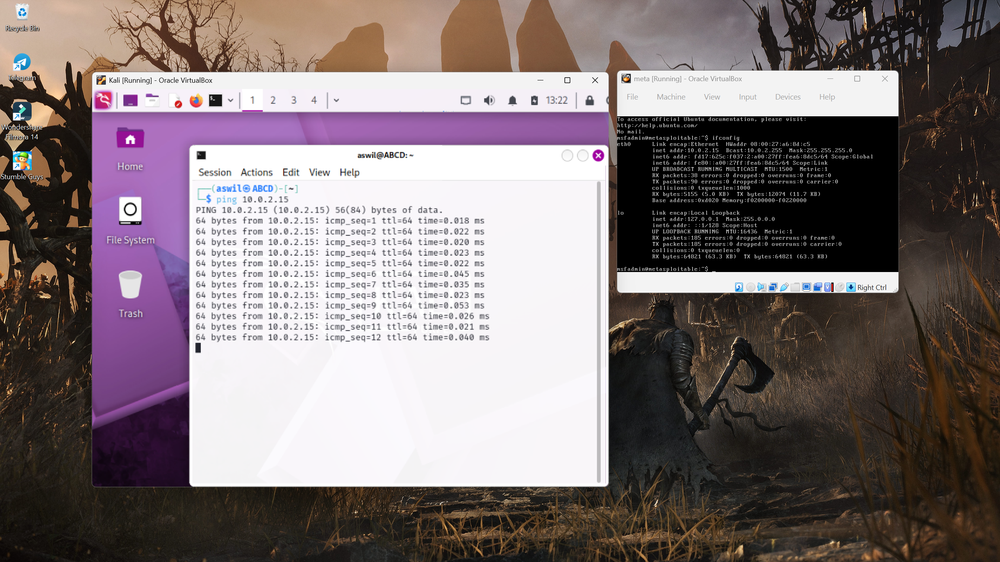

## 1. Build a Personal CyberSecurity Lab

---

## 2. Analyze  recent Cyber Incidents

#### i. [PHP2Shell (20/Oct/2026)](https://en.wikipedia.org/wiki/PHP2Shell)

PHP2Shell is a pair of high-impact computer vulnerabilities (CVE-2026-109618 and CVE-2026-109619) concerning memory safety flaws in PHP versions 5.4–8.5 that allow remote code execution (RCE) by a potential malicious user to gain remote control of the website host. The vulnerabilities were discovered with the help of AI in August 2026 and their existence was publicly announced on 20 October 2026. An emergency patch for versions 8.2, 8.3, 8.4 and 8.5 and details about the vulnerabilities were released the following day, with numerous websites temporarily taken offline to apply the patches before exploits could be used.

#### ii. [Storm-0940 (AI-Assisted Attack)](https://expel.com/blog/storm-0940-artex-attacks-connectwise-app-abuse-and-okta-sign-ups/#1)

Microsoft reported that a threat actor named Storm-0940 used an AI attack framework called ARTEX to target hundreds of organizations. Beyond the ConnectWise incident, this group was also observed abusing Okta self-service registration to create rogue accounts and conduct password spraying.

#### iii. [Plex Media Server](https://blog.senthorus.ch/posts/weekly_reviews/26_10_2026/)

A chain of four vulnerabilities was weaponized almost immediately after technical details became public, allowing unauthenticated remote code execution. Attackers were observed deploying cryptocurrency miners on exposed servers.

---

## 3. Common Attack Types

1. Social Engineering Attacks
	- Phishing: Fraudulent emails/messages that impersonate trusted entities to steal credentials or deliver malware. Variants include **spear phishing** (targeted), **Whaling** (executives), **vishing** (voice), and **smishing** (SMS). 
	- Pre-texting: Fabricating a scenario to manipulate victims into revealing information
	- Baiting: Luring victims with infected USB Drives or fake downloads
	
2. Malware Based Attacks
	- Ransomware: Encrypt data and demands payment.
	- Trojans: Malware disguised as legitimate software.
	- Worms: Self-replicating malware spreading across networks.
	- Spyware/Keyloggers: Covertly capture keystrokes, screenshots, and data.
	- Rootkits: Hide deep in the OS to maintain persistent access.
	- Botnets: Networks of compromised devices used for DDoS or spam.
	
3.  Network Infrastructure attacks
	 - DDoS: Overwhelming services with traffic.
	 - MitM: Intercepting communications like ARP Spoofing, DNS Poisoning.
	 - DNS Spoofing/Cache poisoning: Redirecting traffic to malicious sites.
	 - SQLi: Injecting malicious SQL into input fields to access databases.
	 - XSS: Injecting scripts into web pages viewed by others.
	 - CSRF: Tricking authenticated users into executing unwanted actions.
	 
4. Credential & Authentication attacks
	- Brute-force / credential stuffing: Repeated login attempts using leaked password lists.
	- Password Spraying: Trying common passwords across many accounts.
	- Credential Dumping: Extracting hashes/passwords from memory like mimikatz
	- Session Hijacking: Stealing session cookies and tokens 
	- Pass-the-hash: Reusing captured NTLM hashes for authentication.
	
5. Exploitation & Application attacks
	- Zero-Day Exploits: Attacking previously unknown vulnerabilities 
	- Buffer overflow: Overwriting memory to execute arbitrary code.
	- Privilege Escalation: Gaining higher level permissions
	- Directory Traversal: Accessing files outside intended directories.
	- Insecure Deserialisation: Exploring object Deserialisation to execute code.
	
6. Advanced Persistent Threats (APTs) & Supply Chain
	- APTs: Long Term, Stealthy intrusions by nation-state or organised groups.
	- Supply Chain attacks: Compromising trusted software/vendors
	- Watering hole attacks: Infecting sites frequented by a target group.
	
7. Wireless and Physical attacks
	- Evil Twin / Rogue AP: Fake Wi-Fi access points to intercept traffic
	- WPA Cracking: Breaking wireless encryption.
	- Bluetooth Attacks (Bluejacking, Bluesnarfing)
	
8. AI/LLM Era Attacks
	- Prompt Injection: Manipulating LLM inputs to bypass safeguards.
	- Deepfakes: Synthetic media used for fraud/social engineering
	- AI-generated phishing: Highly convincing, personalized lures at scale

---

## 4. [[Threat Landscape Report]]

---

## 5. Compare Cyber security Domains

| Domain                                             | Primary Focus                             | Typical Roles                                  | Core Skills                                                 |
| -------------------------------------------------- | ----------------------------------------- | ---------------------------------------------- | ----------------------------------------------------------- |
| **Governance, Risk & Compliance (GRC)**            | Policy, risk, audit, regulatory alignment | GRC analyst, risk manager, compliance officer  | Risk assessment, policy writing, audit, NIST/ISO/PCI        |
| **Security Architecture & Engineering**            | Designing secure systems                  | Security architect, security engineer          | Network/system design, threat modeling, cryptography        |
| **Network Security**                               | Protecting network infrastructure         | Network security engineer, firewall admin      | Firewalls, IDS/IPS, segmentation, VPN, routing              |
| **Application Security (AppSec)**                  | Securing software/SDLC                    | AppSec engineer, product security              | Secure coding, SAST/DAST, OWASP Top 10, threat modeling     |
| **Cloud Security**                                 | Securing cloud environments               | Cloud security engineer/architect              | IAM, CSPM, shared responsibility, container security        |
| **Identity & Access Management (IAM)**             | Authentication/authorization              | IAM engineer, identity architect               | SSO, MFA, RBAC/ABAC, PAM, directory services                |
| **Security Operations (SecOps/SOC)**               | Detect, respond, monitor                  | SOC analyst, incident responder, threat hunter | SIEM, EDR, log analysis, IR playbooks                       |
| **Threat Intelligence & Vulnerability Management** | Understand threats, find weaknesses       | Threat intel analyst, vuln manager, pentester  | CVSS, scanning, OSINT, exploit analysis                     |
| **Offensive Security / Pentesting**                | Attack simulation                         | Pentester, red teamer, bug bounty hunter       | Exploitation, recon, privilege escalation, reporting        |
| **Digital Forensics & Incident Response (DFIR)**   | Investigate and contain incidents         | Forensic analyst, IR lead                      | Evidence handling, memory/disk forensics, timeline analysis |
| **Physical Security**                              | Protecting facilities/assets              | Physical security specialist                   | Access control, CCTV, environmental controls                |

