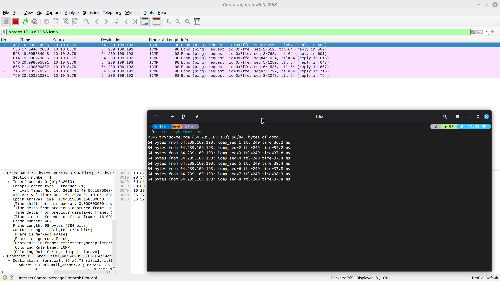

## 1. Analyze packet captures

#### ping packet


#### Nmap Port scan


#### HTTP packet


---
## 2. Perform subnet calculations

Convert mask to binary

```
> ifconfig wlp0s20f3 | grep mask
 
 inet 10.10.8.79  netmask 255.255.254.0  broadcast 10.10.9.255

```

`255.255.254.0` 

255 -> 11111111
254 -> 11111110
0 -> 0
so it is

```
11111111.11111111.11111110.00000000
```

count the bits 
(8x2+7) = 23

| Property               | Value         |
| ---------------------- | ------------- |
| CIDR                   | /23           |
| Host bits              | 32 − 23 = 9   |
| Total addresses        | 2⁹ = 512      |
| Usable hosts           | 2⁹ − 2 = 510  |
| Block size (3rd octet) | 256 − 254 = 2 |

---
## 3. Identify Network Protocols


---
## 4. Build Network Diagrams


---
