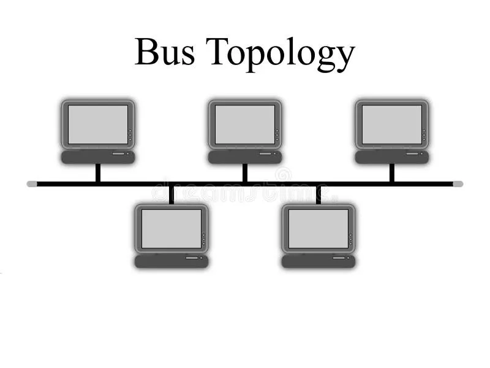
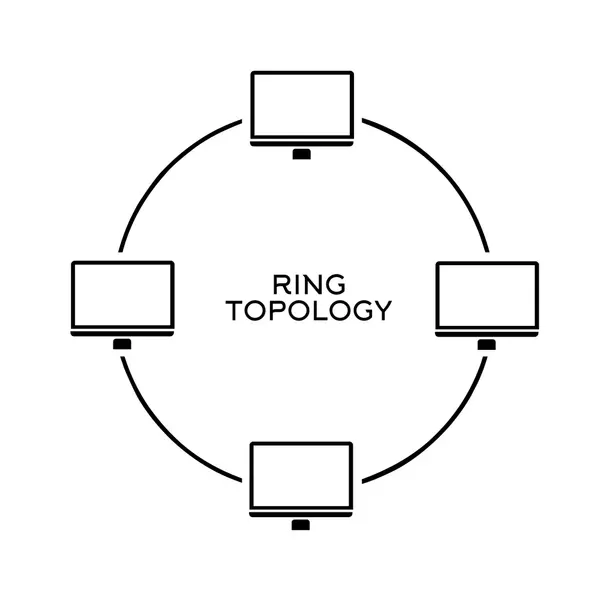
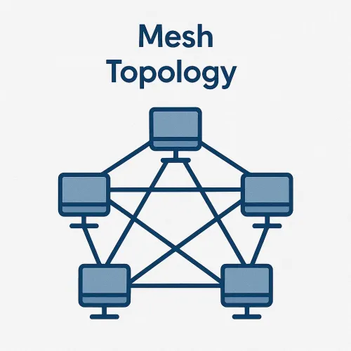
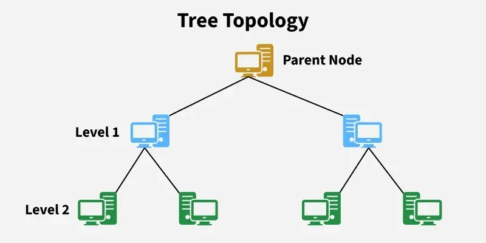
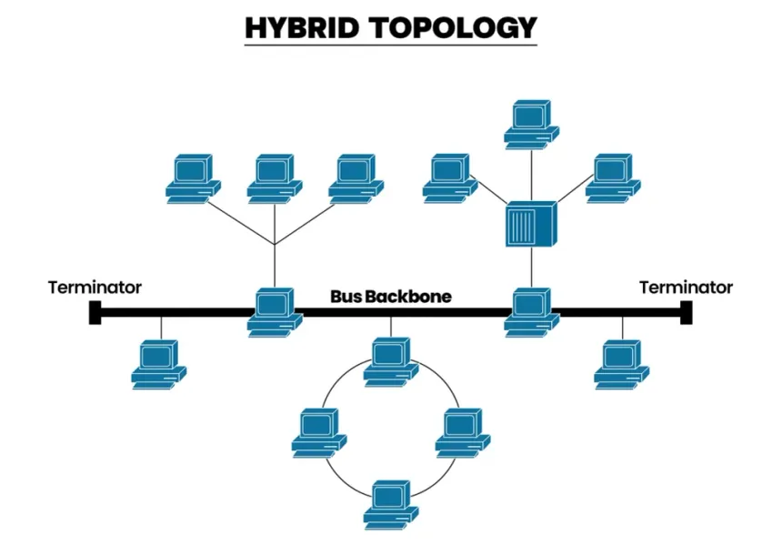

## 1. What is Networking

Networking is a practice of connecting two or more computing two or more computing devices so they can exchange data and share resources (files, printers, internet access, etc.)

Key points:

- A network is a collection of inter connected devices
- The goal is communication and resource sharing
- Network can be a small as two devices or as large as the global internet
- Networking relies on agreed-upon rules (protocols) so different devices can understand each other.

---
## 2. Network communication

Network communication is the process of transferring data from  sender to a receiver across a network

#### core elements in communication

- Sender - device that originates the message.
- Receiver - device that receives the message.
- Message - the data being sent (text, image, video)
- Medium - the path (copper cable , fiber , radio waves)
- Protocol - the rules governing the exchange

#### communication models

- Simplex - one-way only (eg: radio broadcast)
- Half-duplex - two-way but not simultaneously (eg: walkie talkie)
- Full-duplex - two-way simultaneously (eg: phone call)

#### common communication methods

- Unicast - one sender to one receiver.
- Broadcast - one sender to all devices on the network
- Multicast - one sender to a specific group
- Anycast - one sender to the nearest member of a group

---
## 3. Network Architecture

Network architecture is the overall design/structure of a network - how devices are arranged and how they interact.

Two major models:

 1. Client-Server Architecture
	- A central **server** provides services; **clients** request them
	- Pros: centralised control, security, easy management.
	- cons: server is a single point of failure; costly.
	- eg: Web browsing (browser=client, web server = server)

2. Peer-to-Peer (P2P) Architecture
	- All devices are equal
	- Pros: cheap, no central dependency
	- cons: harder to manage and hard to secure
	- eg: file sharing between home computers

#### Networks types by scale

| Type | Full name                 | Scope                       |
| ---- | ------------------------- | --------------------------- |
| PAN  | Personal Area Network     | ~10m (Bluetooth)            |
| LAN  | Local Area Network        | Building/campus             |
| MAN  | Metropolitan Area Network | City                        |
| WAN  | Wide Area Network         | Country / global (internet) |
|      |                           |                             |
#### Topologies

BUS:

STAR:

RING:

MESH:

TREE:

HYBRID:

---
## 4. Network Components

Hardware and software that make up a network:

#### End devices (hosts)

- Computers, laptops, smartphones, servers, printers, IoT devices.

#### Intermediate devices

- Router - connects different networks, directs traffic (works at layer 3).
- Switch - connects devices within a LAN, forwards frames by MAC address (Layer 2)
- Hub - older, broadcasts to all ports (largely obsolete)
- Access Point (AP) - provides wireless connectivity
- Modem - coverts signals for ISP connection
- Firewall - filters traffic for security
- Repeater / Extender - boosts signal

#### Transmission media:

- Wired: twisted-pair (Ethernet), coaxial cable, fiber optic.
- Wireless: Wi-Fi (radio), bluetooth, cellular, satellite.

Network interface:

- NIC (Network interface card) - hardware that connects a device to the network(has a mac address)

#### Software components

- Network operating systems, protocols (TCP/IP, HTTP, DNS), drivers and management tools.

---
## 5. Data Transmission

Data Transmission is a the movement of data (as signals) from one device to another over a medium

#### Key concepts

1. Signal types

	- Analog - continous signal (eg: Human Voice, Rain, Waterfall)
	- Digital - dIscrete 0s and 1s (eg: Mp3, hdmi video, ethernet)

2. Transmission modes

	- Serial - one bit at a time (long distance, eg: USB)
	- Parallel - multiple bits at once (short distance, eg: old printer cables)

3. Direction (see communication modes): SImplex, half-duplex, full-duplex
4. Transmission media: Guided (cables) vs unguided (wireless)
5. Bandwidth v throughput

	- Bandwidth - maximum capacity of a medium.
	- Throughput - actual data transferred per second

6. Switching techniques

	-  circuit switching - dedicated path (traditional phone)
	- Packet switching - data split into packets routed independently (internet)

7. Data encapsulation

	- Data is wrapped with headers at each layer (OSI/TCP-IP) (eg: segments -> packets
	  -> frames -> bits) then reassembled at the receiver.

8. Error detection & correction: Checksums, parity bits, CRC to ensure data integrity.
9. Factors affecting transmission: distance, medium quality, interference/noise, bandwidth, and protocol efficiency.

---
## Reference

- [THM - What is Networking](https://tryhackme.com/room/whatisnetworking)
- [THM - Intro to LAN](https://tryhackme.com/room/introtolan)
